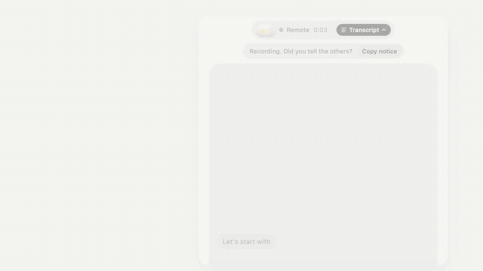

<p align="center">
  
</p>

<h1 align="center">Tacie</h1>

<p align="center">
  <b>Find past decisions during the meeting.</b><br>
  Decisions and to-dos are written up after the meeting.
</p>

<p align="center">
  <a href="https://tacie.app/download/Tacie.dmg"><b>Download for Mac</b></a> ·
  <a href="https://apps.apple.com/app/tacie/id6834710881">iPhone app</a> ·
  <a href="https://tacie.app/en/">tacie.app</a>
</p>

<p align="center">
  <br>
  <sub>Recorded in the official app, which streams the transcript live. With an API key or on-device processing, it is not streamed: it comes in a sentence at a time (see <a href="#4-choose-how-ai-runs">AI choices</a>).</sub>
</p>

Someone asks, "Wait, why did we cut retries to three?" in the middle of a meeting. Tacie finds the answer in your
team's code, issues, docs or past meetings and shows it as a card while the meeting is still going. After the meeting,
it writes the notes: decisions, to-dos and what is still open.

## Two ways to use it

- **The official app** is ready to use: no keys or setup, free with a monthly usage limit. Download it for the
  [Mac](https://tacie.app/download/Tacie.dmg) or get the [iPhone app](https://apps.apple.com/app/tacie/id6834710881).
- **This repository** is the source of the Mac app. Building it yourself gives you an edition without a Tacie account:
  you bring your own AI key or run it on your Mac, and connect tools with personal tokens. The only thing it fetches
  from Tacie is the model files (see [Downloads](#downloads-and-disk-space)), and it sends no usage statistics. iPhone
  sync and one-click connections are only in the official app. There is no prebuilt download: you build it with Xcode,
  as below.

## 1. Requirements

- A Mac with Apple silicon (M1 or later) and macOS 14 or later. On-device speech recognition needs 16 GB of memory.
- Xcode 26 or later, [Rust](https://rustup.rs) (rustup picks the version in `engine/rust-toolchain.toml`),
  XcodeGen, cmake and Xcode's Metal Toolchain:

```sh
brew install xcodegen cmake
xcodebuild -downloadComponent MetalToolchain
```

## 2. Build and install

```sh
git clone https://github.com/basejb/tacie.git
cd tacie/apps/mac
xcodegen generate
xcodebuild -project Tacie.xcodeproj -scheme Tacie -configuration Release -derivedDataPath build.noindex \
  ARCHS=arm64 build
cp -R build.noindex/Build/Products/Release/Tacie.app /Applications/
open /Applications/Tacie.app
```

The first build compiles the search engine and takes several minutes. Tacie lives in the menu bar and shows a small
pill at the top of your screen; the main window opens from there or with ⌃⌥⌘T. After you rebuild, macOS may ask for
the microphone and audio permissions again (the app is signed ad hoc).

To work on Tacie instead, see [Development](#development).

## 3. First launch

A short setup walks you through these steps. You can skip any of them and change everything later in **Settings**.

1. **How do you want to run Tacie?** Pick **API key** or **On-device processing** (next section). **Later** skips
   it: meetings are then recorded but not transcribed or summarized.
2. **Where should Tacie look for answers?** Connect GitHub, Notion, Linear, Jira · Confluence, Asana or an Obsidian
   vault (see [Connect your tools](#5-connect-your-tools)).
3. **Set up meeting audio.** Allow the microphone for in-person meetings, and turn on meeting app audio to hear the
   other side of a call (Zoom, Meet, Teams).
4. When answer cards can run (API key, or Choose providers with cards on), two practice steps follow on sample
   material: asking Tacie a question, and a short practice meeting that shows an answer card.
5. **You're all set.** The shortcuts: ⌃⌥⌘M starts and ends a meeting, ⌃⌥⌘A asks Tacie directly, ⌃⌥⌘T opens the
   main window.

## 4. Choose how AI runs

**Settings → AI** offers two choices, plus **Choose providers** for picking a provider per job.

| | API key | On-device processing |
|---|---|---|
| Speech-to-text | OpenRouter | On your Mac (16 GB memory) |
| Transcript | Not streamed: a sentence at a time | Not streamed: a sentence at a time |
| Meeting notes, main window AI | OpenRouter | Ollama or LM Studio on your Mac |
| Answer cards during meetings | Yes | No (they need a key) |
| What you need | One [OpenRouter](https://openrouter.ai) key; you pay OpenRouter for what you use | Ollama (or LM Studio) and about 7.2 GB of downloads |

**API key.** Paste a key that starts with `sk-or-`. Tacie checks it with OpenRouter and keeps it in your Mac's
keychain.

**On-device processing.** Choosing it downloads the speech model (574 MB). For meeting notes:

1. Install [Ollama](https://ollama.com/download) and open it.
2. In **Settings → AI**, click **Download** next to Gemma 4 E4B. Ollama downloads the model (6.6 GB) and Tacie uses
   it for notes as soon as it is done.

With LM Studio, download Gemma 4 E4B in LM Studio and reopen Settings → AI. A small model on your Mac writes weaker
notes than a hosted model: in our evaluation Gemma 4 E4B captured 27 of 58 decisions where the hosted model captured
54, and took about 85 seconds per meeting on a 24 GB Mac.

**Choose providers** picks a provider for each job: speech-to-text (OpenRouter, on your Mac, Soniox, ElevenLabs;
Soniox streams the transcript live),
meeting notes (OpenRouter, on your Mac, OpenAI, or any address with an OpenAI-compatible chat completions API) and
answer cards (OpenRouter, TypeSafe, or off).

## 5. Connect your tools

In **Settings → Connections**, click **Connect** on a service. A window opens with a link to make a read-only personal
token on that service and a field to paste it. Tacie checks the token, keeps it in your keychain and indexes what it can read on your Mac.
An Obsidian vault or Markdown folder needs no token. [CONNECTING.md](CONNECTING.md) walks through each service.
Answer cards find answers only in what you connect and in your past meetings.

## 6. Use it

- **Start a meeting** with ⌃⌥⌘M or **Start meeting** in the main window: **In-person meeting** listens to the
  microphone, **Remote meeting** also to the meeting app. Where the audio and text go depends on Settings → AI (see
  [What leaves your Mac](#what-leaves-your-mac)).
- When someone asks a question Tacie can answer, a card opens under the pill. Click it for the source.
- When the meeting ends, the notes appear in the main window: summary, decisions, to-dos and open questions. The
  **AI** button there answers questions about your meetings.
- Tacie's windows are hidden from screen sharing and recordings. To include them, turn on **Settings → Privacy → Show in
  screen sharing and recordings**.

## What leaves your Mac

No meeting content goes to Tacie. Where it goes depends on **Settings → AI**:

- **API key**: meeting audio (for speech-to-text), transcripts (for notes), search passages (for answer cards) and
  team terms from your index (for their Korean spellings) go to OpenRouter and the models it routes to, under their
  terms.
- **On-device processing**: meeting audio and transcripts stay on your Mac. Speech recognition runs in Tacie and notes
  are written by Ollama or LM Studio on your Mac.
- **Choose providers**: each job goes to the provider you picked. Meeting audio streams to Soniox (with team terms from
  your index as recognition hints) or goes to ElevenLabs one utterance at a time; if a Soniox stream drops and an
  OpenRouter key is saved, that utterance's audio goes to OpenRouter instead. The meeting notes provider writes all of
  Tacie's text: notes from the transcript, card answers from the question and the shown passages, the main window's
  AI, and spellings of team terms. For answer cards, TypeSafe or OpenRouter also receives the current and recent
  transcript lines and up to 50 search passages, to decide whether to answer and to rank the passages.
- Connected tools are read with your own tokens, and an Obsidian vault or Markdown folder straight from disk. What
  Tacie reads is indexed on your Mac.

## Downloads and disk space

| What | Size | When |
|---|---|---|
| Search model (BAAI bge-m3) and speaker models | 1.2 GB | On first launch |
| On-device speech model (Whisper large-v3-turbo) | 574 MB | When you choose on-device speech |
| Meeting notes model (Gemma 4 E4B, through Ollama) | 6.6 GB | When you click **Download** |

Tacie's models come from `https://models.tacie.app`, where each model folder has its license. To serve them yourself,
copy the same paths to your server and set `TACIE_MODELS_BASE` in `apps/mac/Build.xcconfig`; the files and their
SHA-256 checksums are in `apps/mac/Tacie/Services/ModelDownload.swift`. The notes model comes from Ollama's library.

## Development

```sh
cd apps/mac
./scripts/build.sh      # a Debug build, signed with your Apple Development identity if you have one
open build.noindex/Build/Products/Debug/Tacie.app
./scripts/test.sh       # app tests
(cd ../../engine && cargo test --workspace)   # engine tests
```

A Debug build keeps its own settings and data (Tacie Open Dev), so it does not touch your installed app. With the same
signing identity every build, macOS keeps the permissions between builds. A Debug build can also read keys from files:
the engine reads `~/.config/<name>/config.json` (`{"apiKey": "…"}` for `openrouter` and `typesafe`; `{"token": "…",
"me": "U…"}` for `slack`) unless On-device processing is chosen. Release builds never read these files. In Debug builds
GitHub can also use your `gh` login (Settings → Developer).

Each source file starts with an English summary of what it does; comments further down are often in Korean. Some
refer to design notes such as `docs/04 4절`, which are not published.

## Contributing and support

See [CONTRIBUTING.md](CONTRIBUTING.md). Report security problems privately, as [SECURITY.md](SECURITY.md) explains.
Tacie is maintained by one person, so answers may take a while.

## License

The code is MIT licensed (see [LICENSE](LICENSE)). The license does not cover the name "Tacie", its icon or its
character artwork: if you ship a fork, give it your own name and icon. Third-party code and models keep their licenses
(`apps/mac/Tacie/Resources/ThirdPartyNotices.txt`).
